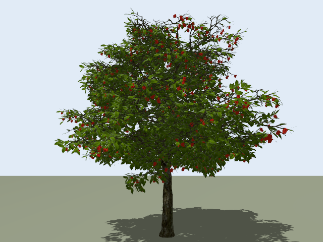

# 荔枝树多视角拍摄规划仿真

基于 Gazebo Harmonic 的单树拍摄实验平台，当前已完成差速小车、相机升降与云台、手动控制、指定三点自动到达和停车拍照。

当前拍摄点由任务配置给定，车辆使用 Gazebo 世界位姿作为理想定位反馈。自动视点选择、果实覆盖评价、A*、RPP、SLAM 与实车验证仍待实现。

## 环境与模型

已在 Gazebo Harmonic 8.15.0、Python 3.10 及本机 `gz.transport13` / `gz.msgs10` Python 绑定、Pillow 环境验证。命令行应能运行 `gz sim`，Python 应能导入上述绑定。

荔枝树素材是独立依赖，本仓库不包含第三方 MAX、Blender、OBJ 或贴图文件。准备好已转换的树模型目录，并设置：

```bash
export LYCHEE_TREE_MODELS_PATH="/你的路径/lychee-tree/models"
```

目录内应有 `lychee_tree/model.sdf` 及它引用的网格、材质文件。也可将模型放在仓库的 `external/lychee-tree/models/`，该目录不进入版本控制。来源及限制见 [THIRD_PARTY.md](THIRD_PARTY.md)。

## 使用

从仓库根目录启动场景：

```bash
bash sim/orchard-rover/start.sh
```

车辆由 Rover Control 面板控制，相机由 Camera Lift and Gimbal 面板控制。相机名义安装高度 0.7–1.8 m，水平 ±170°，俯仰 ±60°。

保持场景运行，在另一终端执行三点自动拍摄：

```bash
bash sim/orchard-rover/run_mission.sh
```

任务期间请勿同时手动控制；Ctrl+C 发送停车指令并结束。照片、配置、实际位置和相机角度记录保存在 `sim/orchard-rover/outputs/missions/` 的独立文件夹。

查看车载图像：

```bash
bash sim/orchard-rover/view_camera.sh
```

在窗口中选择 `/orchard/camera/image`。完整面板操作见 [小车说明](sim/orchard-rover/README.md)。

## 三点执行验证

[示例记录](examples/three-point-capture/)包含本机实际运行得到的三张 640×480 照片及位姿、相机状态、轨迹和验证报告。最大到点误差约 0.043 m，最大偏航误差约 1.915°。这些是功能运行数据，不代表果实检测准确率、覆盖率或实车定位精度。



准备树模型并设置上述环境变量后，可以独立运行任务检查：

```bash
python3 sim/orchard-rover/tools/validate_mission.py
```

执行器检查停车稳定、相机关节到位与图像新鲜度。示例路线包含树干中心 2.5 m 禁入圆检查，该约束不是完整树冠或一般障碍物碰撞检测。

## 文件

- `sim/orchard-rover/`：最新版小车、模型生成器、控制与拍摄任务。
- `sim/orchard-rover/missions/three_points.json`：可编辑的目标点及相机姿态。
- `examples/three-point-capture/`：已完成的三点任务结果。
- `specs/`：实施与验收规格。
- `research/`：文献查阅工作记录，相关判断仍需结合后续研究核验。
- `AI_CONTEXT.md`：项目交接与历史，部分内容包含原开发机器的路径；运行入口以本 README 为准。

下一阶段是核验单果身份，建立“候选视点—可见果实”表，再比较固定照片预算下的选点效果。当前树素材中的 24265 个几何连通分量尚未确认一一对应单果，不能直接用作果实计数真值。
